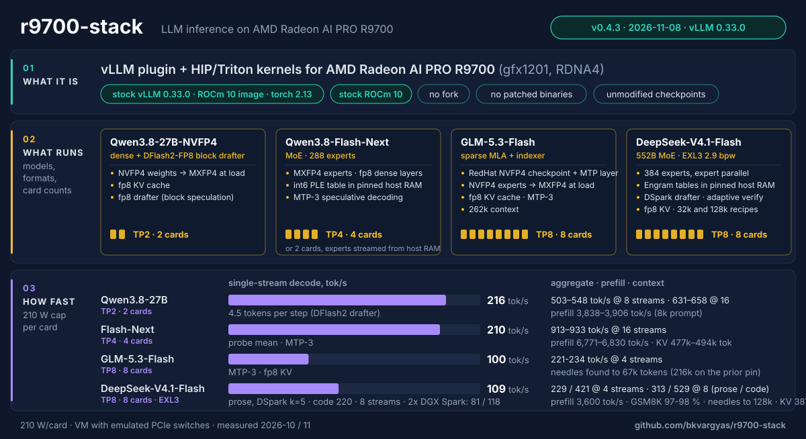

<div align="center">

# r9700-stack

**Big open models, fast, on AMD Radeon AI PRO R9700 cards, on stock vLLM and stock ROCm.**

A vLLM plugin and a set of HIP / Triton kernels for gfx1201 (RDNA4). No fork, no patched source, no vendored binaries,
no re-quantised weights: everything loads at runtime through vLLM's own extension points, so vLLM and ROCm update
underneath it.

[](https://github.com/bkvargyas/r9700-stack/releases/latest)


[](LICENSE)


</div>

> [!NOTE]
> Every number here was measured on one machine: eight R9700s at a 210 W cap in a KVM guest with emulated PCIe
> switches, on a 120 V feed that holds eight-card runs to a -500 MHz clock offset. Your rig will differ; the serve
> scripts carry every knob with the reason next to it.



## What it does

You run the stock vLLM ROCm image with this plugin installed. From there:

1. **Load.** The plugin registers through vLLM's platform, quantization, model and attention-backend entry points and
   brings its own kernel library (`libr9k`, HIP and Triton). The checkpoints are the published ones, unmodified.
2. **Convert at load.** NVFP4 weights become MXFP4 with MSE-searched block exponents; fp8 dense, drafter and lm-head
   GEMMs take per-token fp8 activations; the KV cache is fp8; large tables (Flash-Next's per-layer embedding as int6,
   DeepSeek's Engram tables) go to pinned host memory; EXL3 trellis weights (2-6 bits) serve through exllamav3's gfx1201
   extension and our own batched expert kernel.
3. **Decode on our kernels.** Grouped MoE GEMMs with routing, activation and top-k sum fused around them; WMMA
   weight-only GEMMs with the activation quant fused in; one fused Gated DeltaNet core per layer; sparse-MLA decode
   on split-K kernels; the hyper-connection seams in one launch; the drafters (MTP, DFlash2, DSpark) on the same kernels,
   all inside HIP graphs.
4. **Talk over plain PCIe.** One-kernel all-reduce and all-gather for two, four and eight cards across four PCIe
   switches (pair stages over P2P, the cross-switch stage through pinned host memory), a compressed 4/6-bit all-reduce
   for prefill-sized messages, RCCL above that.
5. **Gate every release.** Kernel unit gates, the integration gate against the installed vLLM, strict sanity above
   `max_num_seqs`, mixed-length soaks and long-context needles on every configuration before a tag; paired GSM8K
   (McNemar) and HumanEval on the numerics.

Current release: **v0.4.3** (2026-11-08), [release notes](notes/release-v0.4.3.md), [CHANGELOG.md](CHANGELOG.md).

## Features

| | |
|---|---|
| 🧠 **Four models, unmodified checkpoints** | **Qwen3.8-27B-NVFP4** with the DFlash2-FP8 block drafter (two cards); **Qwen3.8-Flash-Next** (MoE, 288 experts; four cards, or two with the experts streamed from host RAM); **GLM-5.3-Flash** (sparse MLA + indexer, RedHat NVFP4 with its MTP layer; eight cards); **DeepSeek-V4.1-Flash** (552B MoE, 384 experts, Engram, DSpark) from the published EXL3 2.9 bpw pack (eight cards, tensor + expert parallel). |
| 🧮 **Weight formats handled at load** | NVFP4 → MXFP4 (bit-exact on the 27B), fp8 dense / drafter / lm-head with per-token activations, fp8 KV, int6 and fp8 tables in pinned host RAM, EXL3 trellis with the unshardable pieces dequantized to bf16. |
| ⚡ **Decode kernels** | Fused MoE GEMMs, WMMA weight-only GEMMs, one GDN core per layer, RDNA4-tuned sparse-MLA decode, one-launch hyper-connection seams, fused routing and norms, a multi-row EXL3 GEMV (1-48 rows) and a batched EXL3 expert decode. |
| 🔗 **Collectives over PCIe** | One-shot / two-shot P2P for 2 and 4 cards; an eight-rank all-reduce and all-gather that never cross a root complex (pairs over P2P, the cross stage through pinned host pools); compressed 4/6-bit all-reduce for prefill; RCCL above. |
| 🎯 **Speculative decoding on every family** | MTP-3 (Flash-Next, GLM), DFlash2 (27B), DSpark with adaptive verification (DeepSeek), draft metadata and all-reduces inside the HIP graphs. |
| 📏 **Measured, not guessed** | A per-kernel ledger of the DeepSeek step ([notes/exl3-ledger.md](notes/exl3-ledger.md)) decides what gets built; every serve script's default has its measurement next to it. |
| 🧪 **Gated releases** | Strict sanity above `max_num_seqs`, 15-minute mixed-length soaks, long-context needles, paired GSM8K and HumanEval on every tagged tree, a drafter self-test after every DeepSeek launch ([notes/release-v0.4.2.md](notes/release-v0.4.2.md)). |
| 🧰 **Launchers and benches** | One serve script per configuration (`serve/`), warm-up, sanity, soak, eval and needle tools (`bench/`), kernel unit tests (`tests/`), `R9K_*=stock` to switch any kernel back to vLLM's. |

## Speed

210 W a card, 32k context, single stream unless said otherwise; the full gate tables are in the release notes.

| configuration | single stream | aggregate | prompt processing | KV cache |
|---|---:|---:|---:|---:|
| **Qwen3.8-27B-NVFP4**, 2 cards, DFlash2 | **216-222 tok/s** (4.5 tokens a step) | 527 / 640 at 8 / 16 streams | 3.9k tok/s (8k prompt) | 367k tokens |
| **Qwen3.8-Flash-Next**, 4 cards, MTP-3 | **210-225 tok/s** | 913-944 at 16 streams | 6.8-7.5k tok/s (8k) | ~480k |
| **Qwen3.8-Flash-Next**, 2 cards, experts in host RAM | 122 (Gen3 host) / 143 (Gen5) | 177 / 257 at 8 streams | 2.6k / 3.7k | 221k |
| **GLM-5.3-Flash**, 8 cards, MTP-3 | **93-100 tok/s** | 221-234 at 4 streams | 2.5-3.4k tok/s | 176-210k |
| **DeepSeek-V4.1-Flash** EXL3 2.9 bpw, 8 cards, DSpark k=5 | **104 prose / 215 code** (v0.4.1: 87-97 / 202) | 199-221 prose / 422 code at 4 streams, 317 / 555 at 8 | 3.6k tok/s | 387k (32k) / 392k (128k recipe) |

Two DGX Sparks on TensorFold serve the same DeepSeek pack at 81 prose / 118 code single stream and 154-166 at four
streams. DeepSeek accuracy on this stack: GSM8K 193-196 / 200, needles 9 / 9 to 28k and retrieval at 126.7k-token
prompts, decode flat to 28k of context. How each number was produced, and what was tried and rejected:
[PROGRESS.md](PROGRESS.md) and `notes/`.

## How it fits together

```
OpenAI-compatible clients ──▶ stock vLLM (ROCm 10 image, v0.33.0) ──▶ model classes, attention backends, quant methods
                                       │                                   registered by r9700_vllm at import
                                       ├──▶ libr9k.so (HIP) + Triton kernels      the decode / prefill / MoE / collective kernels
                                       ├──▶ exllamav3's gfx1201 extension         EXL3 trellis GEMV / GEMM (built into the image)
                                       ├──▶ pinned host memory                     offloaded experts, Engram and PLE tables, collective pools
                                       └──▶ 2 / 4 / 8 R9700s over PCIe switches   P2P pair stages, host-memory cross stage, RCCL above 2 MB
```

The image is the pinned stock image plus the plugin (`docker/Dockerfile`); the plugin tree is mounted at `/opt/r9700`
and its kernels are rebuilt by the serve scripts when a source is newer than the library. Every kernel has a stock
fallback behind an `R9K_*` knob, and the integration gate checks the stock entry points the plugin depends on against
the installed vLLM before a tree is served.

## Quick start

You need 2, 4 or 8 Radeon AI PRO R9700s, ROCm 10 on the host, docker, and the weights under `~/models`:
`Qwen3.8-Flash-Next-MXFP4-FP8-GPTQ`, `Qwen3.8-27B-NVFP4` with `Qwen3.8-27B-DFlash2-FP8`, `GLM-5.3-Flash-NVFP4-RedHat`
(eight cards), and for DeepSeek-V4.1-Flash a directory composed of the EXL3 pack's shards and config plus the base
checkpoint's two Engram shards and tokenizer (`serve/ds41-exl3.sh`'s header has the recipe; about 200 GB of host RAM).

**1. Build the image** (the stock vLLM ROCm 10 image plus the plugin; the kernels and exllamav3's extension compile inside):

```sh
docker build -t r9700/vllm:dev docker/
```

The pin (`vllm/vllm-openai-rocm:v0.33.0-rocm100`: vLLM 0.33.0, torch 2.13) is in `docker/Dockerfile`; `--build-arg BASE=` picks another image or nightly.

**2. Serve.** Each script carries the measured defaults with the reason next to every knob:

```sh
bash serve/27b.sh                                                  # Qwen3.8-27B-NVFP4, two cards
GPUS=0,1,2,3 TP=4 OFFLOAD_GB=0 NSEQ=16 bash serve/flashnext.sh     # Qwen3.8-Flash-Next, four cards
bash serve/flashnext.sh                                            # Qwen3.8-Flash-Next, two cards, experts in host RAM
MODEL=/models/GLM-5.3-Flash-NVFP4-RedHat GPUS=0,1,2,3,4,5,6,7 TP=8 OFFLOAD_GB=0 EAGER=0 MTP=3 KVDTYPE=fp8 \
  MAXLEN=32768 NSEQ=4 NBT=8192 KVMEM=2.65 PREFIX_CACHE=0 VLLM_ROCM_USE_AITER=1 R9K_AG_MAX_KB=2048 \
  'SPEC_EXTRA="use_local_argmax_reduction": true' 'R9K_FP8_LINEARS=self_attn\.(in_proj_qkvbfg_a|o_proj|f_b_proj|g_b_proj)$' \
  bash serve/serve.sh                                               # GLM-5.3-Flash, eight cards (notes/glm53.md)
bash serve/ds41-exl3.sh                                            # DeepSeek-V4.1-Flash EXL3, eight cards (notes/exl3-plan.md)
```

An OpenAI-compatible API answers on port 8080 (`PORT=`), model name `Qwen3.8` (`DeepSeek-V4.1` for the DeepSeek
launcher). `MAXLEN=131072 KVMEM=0.8` is DeepSeek's 128k recipe.

**3. Check it.**

```sh
python3 bench/warmup.py                     # the first prompts (Triton JITs, the drafter's warm-up)
python3 bench/sanity_stress.py              # strict 8-way sanity under load
python3 bench/soak.py http://localhost:8080 # mixed-length soak
python3 bench/eval.py                       # paired GSM8K; bench/humaneval.py for HumanEval
```

Notes for the host: cards on the same PCIe switch for tensor parallelism, one card per switch for offloaded experts; a
KVM guest with an emulated PCIe switch needs the overlay in `overlay/emulated-switch` (`OVERLAYS=emulated-switch`, the
serve scripts' default) and the guest kernel flags in [notes/mes-timeouts.md](notes/mes-timeouts.md); the two-card
Flash-Next configuration needs about 120 GB of host RAM; eight-card runs on a 120 V feed need a clock offset
(`host/`).

## Build on it

- **Switch a kernel off:** every `R9K_*` knob takes `stock` or `0`; the serve scripts list them. A/B a change against
  vLLM's own path without rebuilding anything.
- **Add a model:** the model classes in `r9700_vllm/models/` show the pattern (subclass stock's class, rewrite the
  weight names at load, install hooks behind knobs); [notes/exl3-plan.md](notes/exl3-plan.md) is the worked example
  from a published pack to a gated release, [notes/exl3-layer-map.md](notes/exl3-layer-map.md) the layer-by-layer map.
- **Add a kernel:** `kernels/build.sh` lists the sources and the exported symbols, `tests/` the unit gates
  (bit-exact against a torch reference, graph replay equal to eager), [notes/kernel-inventory.md](notes/kernel-inventory.md)
  what exists and why.
- **Move the pin:** [notes/picking-up.md](notes/picking-up.md) is the upgrade recipe for a newer vLLM nightly and the
  release checklist; [notes/vllm-0.33.md](notes/vllm-0.33.md) the last move (to the v0.33.0 release image), [notes/vllm-0.32.md](notes/vllm-0.32.md) the one before.
- **Measure first:** `bench/ds41/ledger/` is the per-kernel step ledger; [notes/exl3-ledger.md](notes/exl3-ledger.md)
  shows how it reads.

## Documentation

| | |
|---|---|
| [`CHANGELOG.md`](CHANGELOG.md), [`notes/release-*.md`](notes/) | What each release changed, and its full validation record. |
| [`PROGRESS.md`](PROGRESS.md), [`PLAN.md`](PLAN.md) | The running log of what was measured, tried and rejected; where the program is going. |
| [`notes/exl3-plan.md`](notes/exl3-plan.md), [`notes/exl3-ledger.md`](notes/exl3-ledger.md) | DeepSeek-V4.1-Flash from the EXL3 pack: architecture, bring-up, the step ledger, the Phase 4 kernel packages and their results. |
| [`notes/glm53.md`](notes/glm53.md) | GLM-5.3-Flash: the sparse-MLA path, the eight-rank collective, the 32k and long-context recipes. |
| [`notes/kernel-inventory.md`](notes/kernel-inventory.md), [`notes/decode-step.md`](notes/decode-step.md) | Every kernel, what it replaces, and the anatomy of a decode step. |
| [`notes/picking-up.md`](notes/picking-up.md) | The release checklist and the upgrade recipe for a new vLLM nightly. |
| [`CREDITS.md`](CREDITS.md), [`notes/independence.md`](notes/independence.md) | Provenance of the kernel structures and the libraries this grew out of. |
| [`docs/`](docs/) | The release graphics and the script that draws them. |

## Development

```
r9700_vllm/      the plugin: models/ quant/ moe/ attn/ comm/ at the top, the entry points in __init__.py
kernels/         the HIP sources and build.sh (libr9k.so); Triton kernels live next to their Python callers
serve/           one launcher per configuration, serve.sh underneath them
bench/           warm-up, sanity, soak, eval, needle, profiling and ledger tools (bench/ds41/ for DeepSeek)
tests/           kernel unit gates (bit-exact references, graph replay) and the integration gate
docker/          the image: the pinned stock vLLM image, the plugin, exllamav3's gfx1201 extension
overlay/ host/   the emulated-switch overlay for KVM guests; host-side clock and power helpers
notes/ docs/     the written record, the graphics
```

Before a tag, every configuration runs the same gate on the same tree and image: the kernel unit gates
(`bench/bringup-tests.sh` runs the single-GPU set in the image), the integration gate, strict sanity above
`max_num_seqs`, a 15-minute mixed-length soak, the long-context needles, and the paired evals. A change that only
improves a benchmark does not ship; three of the last eight releases found their bugs in the soak or the sanity run,
not in the numbers.

## Feedback

Questions, rigs that behave differently, numbers that do not reproduce: [open an issue](https://github.com/bkvargyas/r9700-stack/issues).

## License

Apache-2.0 ([LICENSE](LICENSE), [NOTICE](NOTICE)). The kernel structures' provenance and the libraries this grew out of
are listed in [CREDITS.md](CREDITS.md) and [notes/independence.md](notes/independence.md).
