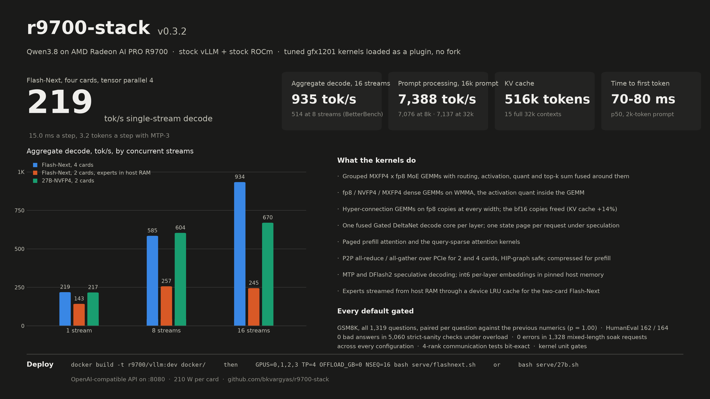

# r9700-stack

Tuned GPU kernels and a vLLM plugin that make **Qwen3.8** run fast on **AMD Radeon AI PRO R9700** cards
(gfx1201 / RDNA4) on **stock vLLM and stock ROCm**. No fork, no patched source, no vendored binaries: everything
loads at runtime through vLLM's own extension points, so vLLM and ROCm update underneath it.

Current release: **v0.3.2** (2026-10-10), [release notes](notes/release-v0.3.2.md), [CHANGELOG.md](CHANGELOG.md).



## What the kernels do

- **MoE experts**: grouped MXFP4 x fp8 GEMMs with the routing, activation, per-token quant and top-k sum fused
  around them; a device LRU expert cache with the experts streamed from pinned host memory for the two-card
  Flash-Next configuration.
- **Dense layers**: fp8 and NVFP4/MXFP4 weight-only GEMMs on WMMA, the activation quant fused into the GEMM at
  decode widths; NVFP4 checkpoints converted to MXFP4 at load.
- **Hyper-connections** (Flash-Next): the down + hc_silu and up + gated-mean GEMMs on fp8 copies of the weights at
  every row count, the bf16 copies freed after quantisation; combine-norm and gate-mix kernels for prefill.
- **Attention and recurrence**: paged attention for prefill, the query-sparse attention indexer and attention
  kernels, one fused Gated DeltaNet decode core per layer (conv update, gating, recurrence, norm), one GDN state
  page per request under speculative decoding.
- **Communication**: P2P all-reduce and all-gather over PCIe for 2 and 4 cards (one-shot and two-shot, fine-grained
  memory, HIP-graph safe), a compressed 4/6-bit all-reduce for prefill-sized messages, RCCL above that.
- **Speculative decoding**: MTP (Flash-Next) and the DFlash2 block drafter (27B) on the same kernels, with an int6
  per-layer-embedding table in pinned host memory.
- **Memory**: the KV cache sized from what the model actually uses, not torch.compile's transients; cudagraphs
  only where they pay.

Every default ships gated: the full 1,319-question GSM8K set paired per question against the previous numerics
(McNemar), HumanEval, strict sanity under overload, a 25-minute mixed-length soak on every configuration, the
multi-rank communication tests and the kernel unit gates. v0.3.2: GSM8K 95.75% (paired p = 1.00 against v0.3.1),
HumanEval 162 / 164, 0 bad answers in 5,060 strict-sanity checks, 0 errors in 1,328 soak requests.

## Speed (v0.3.2, 210 W with a -42 mV offset, 32k context)

**Qwen3.8-Flash-Next (MXFP4 experts, fp8 dense), four cards, TP4, MTP-3**

| | |
|---|---:|
| single-stream decode | 219 tok/s, 15.0 ms a step |
| aggregate decode at 1 / 2 / 4 / 8 streams (BetterBench) | 172 / 261 / 403 / 514 tok/s |
| aggregate decode at 8 / 16 streams (probe) | 582-589 / 933-935 tok/s |
| time to first token | 70-80 ms |
| prompt processing at 2k / 8k / 16k / 32k | 5,189 / 7,076 / 7,388 / 7,137 tok/s |
| KV cache | 515,577 tokens |

**Qwen3.8-Flash-Next, two cards, TP2, experts in host RAM**

| | PCIe Gen3 host (test box) | PCIe Gen5 host (production) |
|---|---:|---:|
| single-stream decode | 122 tok/s | 143 tok/s |
| aggregate at 8 / 16 streams | 177 / 163 | 257 / 245 |
| prompt processing at 8k | 2,594 | 3,724 |
| KV cache | 221,184 tokens | |

**Qwen3.8-27B-NVFP4, two cards, TP2, DFlash2 speculative decoding**

| | |
|---|---:|
| single-stream decode | 211-217 tok/s (4.3 tokens a step), 23 ms a step |
| aggregate at 8 / 16 streams | 582-604 / 657-670 tok/s |
| prompt processing at 8k | 3,948-4,143 tok/s |
| KV cache | 367,494 tokens |

How each number was produced, and what was tried and rejected: [PROGRESS.md](PROGRESS.md) and `notes/`.

## Deploying it

Requirements: 2x or 4x Radeon AI PRO R9700, ROCm 10 on the host, docker, the model weights under `~/models`
(`Qwen3.8-Flash-Next-MXFP4-FP8-GPTQ`, `Qwen3.8-27B-NVFP4` with `Qwen3.8-27B-DFlash2-FP8`).

1. **Build the image** (stock vLLM ROCm 10 nightly plus the plugin; the kernels compile inside):
   ```
   docker build -t r9700/vllm:dev docker/
   ```
   The pinned nightly is in `docker/Dockerfile` (`--build-arg BASE=` for another).
2. **Serve**:
   ```
   bash serve/27b.sh                                                  # 27B-NVFP4, two cards
   GPUS=0,1,2,3 TP=4 OFFLOAD_GB=0 NSEQ=16 bash serve/flashnext.sh     # Flash-Next, four cards
   bash serve/flashnext.sh                                            # Flash-Next, two cards, experts in host RAM
   ```
   OpenAI-compatible API on port 8080 (`PORT=`), model name `Qwen3.8`. Every serve script carries the measured
   defaults with the reason next to each knob; `R9K_*=stock` or `=0` switches any kernel back to vLLM's.
3. **Check it**: `python3 bench/warmup.py`, then `bench/sanity_stress.py` (strict 8-way sanity under load),
   `bench/soak.py` (mixed-length soak), `bench/eval.py` (paired GSM8K), `bench/humaneval.py`. Kernel unit tests
   are in `tests/`; `bench/bringup-tests.sh` runs the single-GPU set in the image.

Notes for the host: cards on the same PCIe switch for tensor parallelism, one card per switch for offloaded
experts; a KVM guest with an emulated PCIe switch needs the overlay in `overlay/emulated-switch`
(`OVERLAYS=emulated-switch`, the serve scripts' default) and the guest kernel flags in
[notes/mes-timeouts.md](notes/mes-timeouts.md); the two-card Flash-Next configuration needs about 120 GB of host RAM.
The release checklist and the upgrade recipe for a newer vLLM nightly are in [notes/picking-up.md](notes/picking-up.md).

## Licence and credits

Apache-2.0 ([LICENSE](LICENSE)); provenance of the kernel structures and the libraries this grew out of in
[CREDITS.md](CREDITS.md) and [notes/independence.md](notes/independence.md).
